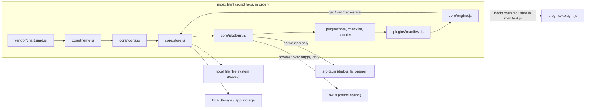

# project map

a guided tour of the repo for contributors (human or ai). if you only read one
section, read [how it fits together](#how-it-fits-together).

## at a glance



## files

### the app (runs as-is, no build step)

| path | role |
|---|---|
| `index.html` | the shell: menubar, canvas, settings sidebar markup, and every `<script>` tag in load order. |
| `core/engine.js` | the kernel. owns `state`, saving, drag/resize/snap, the 7 built-in panels, the plugin loader, settings, export/import. the only file plugins never touch. |
| `core/store.js` | layered key/value storage: a connected local file (file system access api) -> claude artifact storage -> `localStorage` -> memory. reads from the first that has data, writes to all. |
| `core/platform.js` | hides where the app is running. `Track.platform.saveFile` (native save dialog), opens `target="_blank"` links in the system browser inside the native app, registers `sw.js` in browsers. |
| `core/theme.js` | the 7 themes x light/dark. sets `--background`, `--main` and `--chart-1..5` on `:root`. |
| `core/icons.js` | inline svg icon strings, handed to plugins as `api.icons`. |
| `core/styles.css` | all shared styles and the css variables plugins are expected to use. mobile layout lives at the bottom (`max-width: 760px`). |
| `plugins/manifest.js` | `window.TrackExtraPlugins`: which plugin files to load beyond the three defaults. a `.js` file (not `.json`) so it works from `file://`. |
| `plugins/*.plugin.js` | one plugin each. `note`, `checklist`, `counter` load via static script tags; the rest load from the manifest. |
| `vendor/` | chart.js 4 and the dm sans variable font, each with its license. |
| `assets/icon.svg` | the source app icon. `assets/icons/` holds the generated pwa pngs. |
| `sw.js` | service worker: precaches the shell, stale-while-revalidate for same-origin files. bump `CACHE` when the shell list changes. |
| `manifest.webmanifest` | pwa install metadata. |

### tooling

| path | role |
|---|---|
| `package.json` | npm scripts. the only dependency is `@tauri-apps/cli`, and only for native builds. |
| `scripts/build-web.mjs` | copies the app into `dist/` (what tauri and github pages ship). |
| `scripts/serve.mjs` | zero-dependency static server for testing the pwa locally. |
| `scripts/check.mjs` | ci checks: js syntax, manifest <-> files, the plugin contract, no hardcoded colors in plugins. |
| `.github/workflows/ci.yml` | runs `npm run check` + `build:web` on every push and pr. |
| `.github/workflows/pages.yml` | deploys `dist/` to github pages from `main`. |
| `.github/workflows/release.yml` | on a `v*` tag: builds windows installers and an android apk, attaches them to a draft release. |

### native wrapper (`src-tauri/`)

| path | role |
|---|---|
| `tauri.conf.json` | app name, identifier, window, csp, bundle settings. `version` is read from `package.json`. |
| `Cargo.toml`, `src/lib.rs`, `src/main.rs` | a thin rust shell: registers the dialog, fs and opener plugins, then runs the webview. no app logic lives here. |
| `capabilities/default.json` | exactly what the webview may call: save dialog, write a text file, open urls. |
| `icons/` | generated from `assets/icon.svg` by `npm run icons`. |
| `gen/android/` | the generated android studio project (committed; build output is ignored). release signing hook in `app/build.gradle.kts`. |

## how it fits together

**boot** (`engine.js` -> `init()`):
1. load each file in `TrackExtraPlugins`, one at a time, recording a warning for any
   that 404s, throws, or never calls `TrackPlugins.push`.
2. `buildModules()`: merge the 7 built-in panels and every registered plugin into one
   `MODULES` registry. plugins are wrapped so they only ever see the small `api` object.
3. render the default layout, reconnect a previously chosen local file if the browser
   still allows it, then load saved state and re-render.

**state** is one json object, saved under the key `track-state`:

```js
{
  version: 1,
  theme: 'blue', dark: false, sharp: false, goal: 80,
  month: { y, m },                     // shared by tracker, calendar, insights
  habits: [{ id, name }],
  tracker: { 'y-m-d': { [habitId]: true } },   // m is 0-based here
  kanban: { columns: [{ id, title, cards: [{ id, text, done }] }] },
  notes: '',
  images: { card, carousel: [] },
  elements: [                          // everything on the canvas
    { id: 'tracker', type: 'tracker', x, y, w, h, z, visible },   // built-in panel
    { id: 'a1b2c3d4', type: 'pomodoro', x, y, w, h, z, data: {} } // plugin instance
  ]
}
```

a plugin's whole world is its instance's `data`. it reads it with `api.getData(id)`,
mutates it in place, then calls `api.save()` (debounced, 500 ms) and
`api.rerender(id)`. see [`docs/PLUGIN_GUIDE.md`](docs/PLUGIN_GUIDE.md).

**saving** writes to every available backend at once, and also on `visibilitychange`
and `pagehide`, so closing the tab or app doesn't lose the last edit.

**where it runs:**

| | storage | export | offline |
|---|---|---|---|
| browser from disk (`file://`) | localStorage, optional local file | browser download | yes (no network needed except picsum images) |
| browser / pwa over http(s) | same | browser download | service worker |
| windows app (webview2) | app's webview storage | native save dialog | bundled |
| android app (webview) | app's webview storage | native save dialog | bundled |

## conventions

- all visible text is lowercase (enforced by `text-transform` too).
- colors only come from css variables, so every theme and dark mode just work.
- plugins reuse existing classes (`.icon-btn`, `.shuffle-btn`, `.kadd`, `.ktick`,
  `.mini-x`, `.cal-*`, `.stat`, `.progress-*`) and inline styles built from variables.
- user text always goes through `escapeHtml` before it reaches `innerHTML`.
- no network calls from plugins; no new runtime dependencies without a good reason.
- if unsure whether something belongs in the engine or a plugin: plugin.
