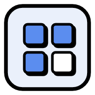
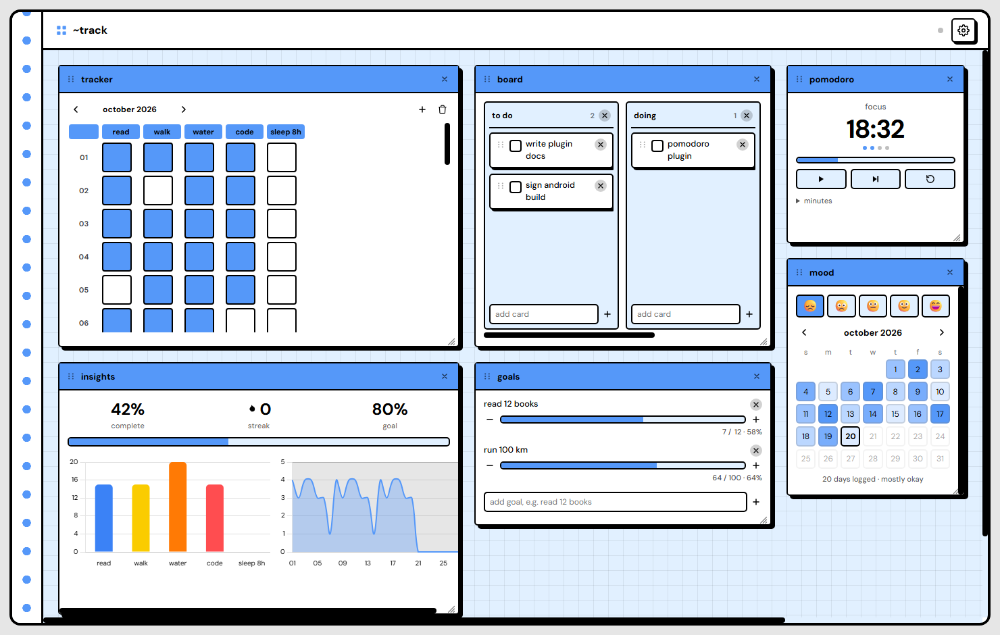

<div align="center">



# ~track

a minimal, local-first dashboard: a habit tracker, a kanban board, notes, a calendar,
a progress-insights panel and a growing set of plugins, all as movable, resizable
panels on a plain checkered-paper canvas. everything is lowercase, on purpose.

no account, no server, no build step. open `index.html` and it works.
or install it on windows and android.

[features](#features) · [install](#install) · [plugins](#plugins) · [building](docs/BUILDING.md) · [project map](PROJECT_MAP.md) · [contributing](CONTRIBUTING.md)



</div>

## features

- **tracker**: a month of habits as solid-fill checkboxes, not a spreadsheet
- **board**: a small kanban with editable columns and cards you drag between them
- **insights**: completion rate, longest streak, a couple of charts
- **calendar**, **notes**, **moments** (an image carousel), **focus** (a single image card)
- **12 plugins** you can add as many times as you like (see [plugins](#plugins))
- 7 color themes, dark mode, and a "sharp" flat-shadow mode
- everything on the canvas is draggable, resizable, and snaps to a grid
- **local-first storage**: saves to the browser (or the app) by default; on chromium
  browsers you can also connect a real `track-data.json` file in settings -> storage
- export/import, per-element or everything at once
- **works offline**: chart.js and the font are vendored, nothing loads from a CDN

## install

| where | how |
|---|---|
| **any browser** | clone or download the repo, open `index.html`. that's it. |
| **windows** | download the `.exe` (or `.msi`) installer from [releases](../../releases). |
| **android** | download the `.apk` from [releases](../../releases) and open it (allow "install unknown apps" for your browser/file manager when asked). |
| **as a web app (pwa)** | open the hosted version (or `npm run serve` locally) in chrome/edge, then *install app* from the address bar or menu. works on desktop and android. |

your data never leaves your device. in the installed apps it lives in the app's own
storage, so use settings -> export -> everything to move it between devices, and
import backup on the other side.

## plugins

every extra element type is a single, independent javascript file in `/plugins`.
there's no special casing for the ones that ship with the app; a community plugin
works exactly the same way.

| plugin | what it does |
|---|---|
| note | a title and a freeform text area |
| checklist | a lightweight to-do list |
| counter | a number with +/- |
| quote | a rotating line of text |
| countdown | live days/hours/minutes/seconds until a date |
| puzzle | a 3x3 sliding puzzle, optionally with your own image |
| **pomodoro** | focus / short break / long break timer that survives reloads, with a chime |
| **mood** | one mood a day, shown as a month of theme-shaded squares |
| **journal** | one entry per day, with a gentle prompt on empty days |
| **goals** | measurable goals with progress bars ("read 12 books") |
| **budget** | a monthly money log with in / out / net, any currency |
| **links** | a short list of bookmarks you open every day |

to add one: drop the file in `/plugins`, add its filename to
`window.TrackExtraPlugins` in `plugins/manifest.js`, refresh.

to write one: read [`docs/PLUGIN_GUIDE.md`](docs/PLUGIN_GUIDE.md), then
`plugins/quote.plugin.js`; the guide walks through that exact file. run
`npm run check` before opening a pull request.

## layout

```
index.html              the app shell: markup + script tags, in load order
core/                   engine, storage, themes, icons, platform bridge, styles
plugins/                one file per plugin, plus manifest.js
vendor/                 chart.js and the dm sans font, vendored
assets/                 app icon (svg source + generated pngs)
sw.js, manifest.webmanifest   offline support and pwa install
src-tauri/              the native windows + android wrapper (tauri 2)
scripts/                build-web, serve, check -- zero-dependency node scripts
docs/                   plugin guide, build guide
```

the full file-by-file map, data model and boot sequence are in
[`PROJECT_MAP.md`](PROJECT_MAP.md).

## development

```sh
# just the web app: no install needed
open index.html                  # or double-click it

# with node 22+
npm install                      # only needed for the native app builds
npm run serve                    # http://localhost:5173, with the service worker
npm run check                    # syntax + plugin contract checks (what ci runs)

# native apps (see docs/BUILDING.md for prerequisites)
npm run desktop:dev              # run the windows/desktop app
npm run desktop:build            # build .exe + .msi installers
npm run android:dev              # run on a connected device / emulator
npm run android:build            # build the .apk
```

## storage

data saves to the browser by default (with an in-memory fallback so it never throws,
even somewhere unusual). on chromium-based browsers, settings -> storage lets you
connect a real local `track-data.json`: back it up, put it in a synced folder, put it
in git, whatever you'd do with any other file on disk. browser storage keeps working
underneath as a redundant copy either way.

## contributing

see [`CONTRIBUTING.md`](CONTRIBUTING.md). plugins are the easiest way in.
please read the [code of conduct](CODE_OF_CONDUCT.md), and report security issues
as described in [`SECURITY.md`](SECURITY.md).

## license

MIT, see [`LICENSE`](LICENSE). bundled third-party code keeps its own license:
chart.js (MIT, `vendor/chart.js.LICENSE.md`) and dm sans (SIL OFL 1.1,
`vendor/fonts/OFL.txt`).
